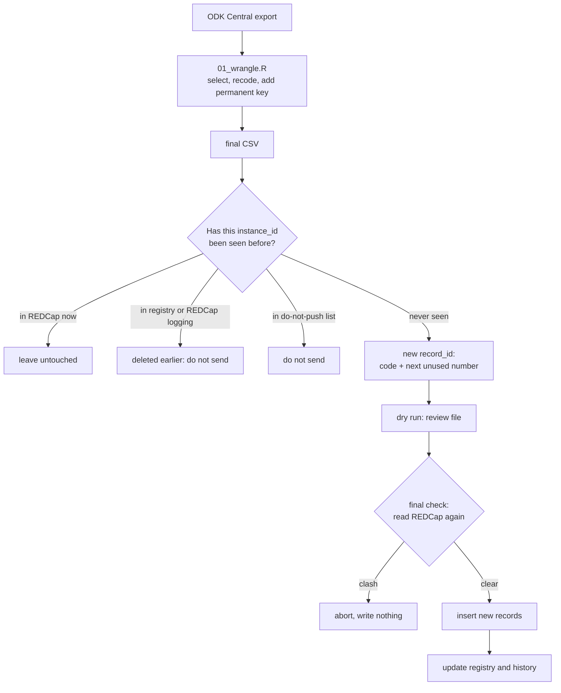

# ODK to REDCap: insert-only push

R scripts that send new ODK Central submissions to REDCap **without ever overwriting, duplicating or bringing back records that your team has already cleaned in REDCap.**

Many field projects collect data with ODK and clean it in REDCap, because REDCap keeps an audit trail of every correction and makes it easy to remove duplicates. The weak point is the push between the two. This repository makes that push safe by design.

## The problem

A common way to push ODK data to REDCap is to build `record_id` as a code plus a row number (`P0012_1`, `P0012_2`, ...) and to send every row whose `record_id` is not in REDCap yet. It looks safe, because existing IDs are skipped. In practice:

- **ODK exports the newest submission first.** When a new submission arrives for a code that already has records, every older submission for that code moves up one number. The oldest one lands on an unused number and is sent again, uncorrected. The new one takes a number that already exists and is silently skipped.
- **A record renamed in REDCap** (for example after fixing a wrong code) no longer matches anything, so it is sent again.
- **A duplicate deleted in REDCap** comes back on the next push.

For the people cleaning data in REDCap, it looks as if their corrections were undone. The test suite in this repository reproduces it: on synthetic data, the second run of that usual push sent 20 old submissions again (including both deleted and both renamed records) and silently skipped 16 of 65 new ones.

## What this push guarantees

1. Only submissions that have never been sent to REDCap are inserted.
2. Records that already exist in REDCap are never updated or overwritten.
3. Corrections made directly in REDCap are always kept.
4. Records deleted in REDCap are not sent again.

## How it works



- **Match on the submission, not on the record ID.** Every submission carries its permanent ODK key (`KEY`, which stays the same when a submission is edited in ODK Central). It is stored in the REDCap field `instance_id` and is the only thing used to decide whether a submission was already sent.
- **Remember everything ever sent.** A local registry keeps every key the push has sent or seen in REDCap. The REDCap logging is also read, so records deleted before the registry existed are recognised too. A hand-kept do-not-push list covers anything else.
- **Never reuse a record ID.** New IDs take the next number after the highest one ever used for that code, in REDCap now, in the registry or in the logging. Forms without a code become `NOID_1`, `NOID_2`, ...
- **Look before writing.** A dry run lists exactly what would be sent. Just before writing, REDCap is read again and nothing is written if any record ID or key of the batch is already there. The write itself uses `overwrite_with_blanks = FALSE`.

## Repository layout

| Path | What it is |
|---|---|
| `01_wrangle.R` | Step 1: reads an ODK export, keeps the REDCap variables, recodes, writes the final CSV |
| `02_push.R` | Step 2: settings, project list and the push loop |
| `R/odk_helpers.R` | `read_odk_csv()` and `add_submission_key()` |
| `R/redcap_insert_only.R` | All push functions, including `push_project()` |
| `example/` | Synthetic ODK export and the script that generates it |
| `tests/test_insert_only.R` | Test suite with a simulated REDCap server |
| `docs/how-it-works.md` | Step-by-step description of the push and of the files it creates |
| `.Renviron.example` | Template for the API address and tokens |

## Requirements

- R 4.1 or newer and the packages `dplyr`, `readr`, `stringr`, `lubridate`, `tibble` and `REDCapR` (1.2.0 or newer).
- A classic REDCap project (not longitudinal, no repeating instruments) whose fields include `record_id` (first field), `instance_id` and `submission_date` (text), plus your form's own fields.
- An API token with **API Export** and **API Import/Update** rights. The **Logging** right is strongly recommended.

```r
install.packages(c("dplyr", "readr", "stringr", "lubridate", "tibble", "REDCapR", "usethis"))
```

## Quick start

1. **Download or clone** this repository and open it as your working directory (in RStudio, open the folder as a project).
2. **Store the API address and tokens outside the code.** Run `usethis::edit_r_environ()`, copy the lines from `.Renviron.example`, fill in your values, save, and restart R. Tokens never go in a script.
3. **Prepare the data.** Put your ODK export in the folder and adapt the file name and the `select()` list in `01_wrangle.R`. Run it. (Out of the box it uses the synthetic file in `example/`.)
4. **Dry run.** In `02_push.R`, list your projects in the `projects` table, keep `dry_run = TRUE` and run the whole script. Nothing is written; review files appear in `push_logs/`.
5. **Push.** Check `push_logs/<PROJECT>_to_push_<time>.csv`, set `dry_run = FALSE`, run again and type YES when asked. Then set `dry_run` back to `TRUE` and run once more: every project should report 0 new submissions.

## What you see in the console

For each project the push prints how every ODK submission was classified:

| Status | Meaning |
|---|---|
| already in REDCap (left untouched) | The key is in REDCap. The record is not changed, whatever its content. |
| in do-not-push list | The key is in the project's do-not-push file. |
| sent before, no longer in REDCap (deleted) | The key is in the registry or the logging, so the record was deleted and is not sent again. |
| new | Never sent before. Only these rows are pushed. |

It also lists any submission that already sits in more than one REDCap record (typically a copy left by an earlier push), so the unwanted copy can be deleted. It will not come back.

## Test it without a REDCap server

```bash
Rscript tests/test_insert_only.R
```

The test builds a fake REDCap in memory, replaces the REDCapR read, write and logging functions with fakes, and uses synthetic submissions. Part A shows the problem with the usual push. Part B checks the rules:

```
=== Part B: insert-only push ===
  [PASS] dry run writes nothing
  [PASS] rule 2: every existing record is unchanged
  [PASS] rule 3: corrections made in REDCap are kept
  [PASS] rule 4: deleted records are not sent again
  [PASS] renamed records are not sent again
  [PASS] rule 1: exactly the never-sent submissions are inserted
  [PASS] new record IDs never reuse an old, renamed or deleted ID
  [PASS] the push writes only creations, never updates
  [PASS] a second run inserts nothing
  [PASS] a record deleted after a push stays deleted, even without the Logging right
  [PASS] if REDCap cannot be read, the push stops
  [PASS] a clash found just before writing aborts the write
  [PASS] the new submission then goes in once, with the next free ID (P9999_2)

13 of 13 checks passed
```

## Good practice

- Keep tokens in `.Renviron`, never in scripts, e-mails or chats. Regenerate a token if it is ever exposed.
- Use the raw download from ODK Central. Opening the CSV in Excel and saving it rewrites dates and can change text.
- In RStudio, turn off "Restore .RData into workspace at startup" and "Always save history", so old objects and typed tokens are not kept.
- Back up the `push_registry/` folder. It is the push's memory of what was sent.
- The `.gitignore` keeps data, registries, logs and credentials out of the repository. Do not commit real data.

## Limitations

- Changes made in ODK Central after a submission was pushed are not carried over to REDCap. That is the point of the design: once a record is in REDCap, REDCap is the reference and corrections are made there.
- Classic projects only (no longitudinal events or repeating instruments).
- Without the Logging right, records deleted before the first run can only be blocked through the do-not-push list. Records deleted after the first run are always remembered by the registry.

## License

MIT. See `LICENSE`. The example data and the test data are synthetic.
